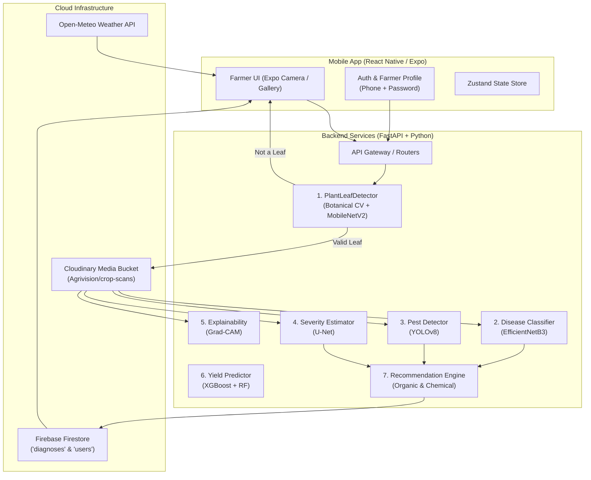

# 🌾 Agrivision AI+

> **Next-Generation AI & Computer Vision Smart Agriculture Platform for Indian Farmers**

[](https://python.org)
[](https://fastapi.tiangolo.com)
[](https://expo.dev)
[](https://tensorflow.org)
[](https://ultralytics.com)
[](https://cloudinary.com)
[](https://firebase.google.com)

Agrivision AI+ is an end-to-end precision agriculture and crop health diagnostic platform designed for Indian farmers. By integrating deep convolutional neural networks, computer vision, multi-spectral botanical foliage validation, real-time meteorological forecasting, and cloud persistence (Cloudinary & Firebase Firestore), the platform empowers farmers to detect crop diseases, assess damage severity, detect pests, and receive localized organic and chemical recommendations in their native language (**English**, **मराठी - Marathi**, **हिंदी - Hindi**).

---

## 📸 Key Features

### 1. 🌿 Intelligent Leaf & Plant Pre-Verification (OOD Detection)
- **Problem Solved**: Standard classification models produce false positive diagnoses on random objects (e.g. faces, desks, laptops, cloth).
- **Solution**: Multi-stage botanical foliage and deep semantic validator:
  - **Botanical Chlorophyll & Chlorosis**: Excess Green Index ($\text{ExG} = 2G - R - B$) and Normalized Excess Green ($\text{NExG} = \frac{2G - R - B}{R + G + B + \epsilon}$).
  - **Human Skin / Body Part Rejection**: $YC_bC_r$ chroma filtering ($C_r \in [133, 173], C_b \in [77, 127]$) to reject selfies, fingers, or portraits.
  - **Deep Semantic Object Filter**: MobileNetV2 ImageNet-1k backbone to distinguish botanical foliage from manufactured indoor objects.
  - **Farmer Friendly Warning**: Gracefully alerts the farmer with `"🌱 No Plant or Leaf Detected"` and a one-click `"Retake Photo"` action.

### 2. 🔬 Disease Diagnosis (EfficientNetB3 - 38 Classes)
- Classified against 38 canonical PlantVillage crop-disease categories (Tomato, Potato, Wheat, Rice, Apple, Corn, Grape, Pepper, Strawberry, etc.).
- Softmax confidence scoring and top-5 ranked candidate predictions.

### 3. 🐛 Real-time Pest Detection (Ultralytics YOLOv8)
- Bounding-box detection for 7 destructive agricultural pests:
  - Aphids, Whitefly, Armyworm, Stem Borer, Leafhopper, Thrips, and Mites.

### 4. 📊 Disease Severity Segmentation (U-Net)
- Pixel-level semantic segmentation identifying healthy leaf tissue vs. necrotic lesions.
- Calculates exact affected percentage and severity tier (`Healthy`, `Mild`, `Moderate`, `Severe`, `Critical`).

### 5. 🔍 Explainable AI (Grad-CAM)
- Class Activation Mapping (Grad-CAM) visually highlights the exact spots and veins that influenced the model's prediction.
- Heatmaps are automatically generated and saved to Cloudinary.

### 6. ☁️ Cloudinary & Firebase Firestore Cloud Sync
- **Cloudinary**: High-resolution leaf scans and Grad-CAM heatmaps uploaded to folder `Agrivision/crop-scans` and `Agrivision/explainability`.
- **Firebase Firestore**: Every completed diagnosis, farmer profile, disease metrics, severity score, and treatment plan is automatically persisted to collection `diagnoses` and `users` via the Firebase Admin SDK.

### 7. ⛅ Live Weather & Hyperlocal Forecast
- Real-time meteorological data via Open-Meteo for Sangamner, Ahilyanagar (Temperature, Relative Humidity, Rain, Wind Speed, UV index, and 7-day forecast).

### 8. 🌾 Farmer Profile & Mobile Authentication
- Clean Mobile Number + Password registration and login (no OAuth client errors).
- Tracks farmer metadata: Full Name, Mobile, Village (e.g. *Gunjalwadi*), Taluka/District (*Sangamner, Ahilyanagar*), State (*Maharashtra*), Farm Acreage, and Primary Crops (*Tomato, Soybean, Wheat, Cotton, etc.*).

---

## 🏗️ System Architecture



---

## 🧠 Model Suite Summary

| Model | Architecture | File Location | Task | Status |
|---|---|---|---|---|
| **Plant & Leaf Validator** | MobileNetV2 + Multi-spectral CV | `backend/app/ml/disease/leaf_detector.py` | Out-Of-Domain leaf validation | ✅ Active |
| **Disease Classifier** | EfficientNetB3 (Keras) | `ml/models/weights/efficientnetb3_disease.h5` | 38 Crop-Disease Classes | ✅ Active |
| **Pest Detector** | Ultralytics YOLOv8 (PyTorch) | `ml/models/weights/yolov8_pest.pt` | Bounding-box pest detection | ✅ Active |
| **Severity Estimator** | U-Net Segmentation | `ml/models/weights/unet_severity.h5` | Pixel lesion segmentation | ✅ Active |
| **Explainability** | Grad-CAM | `backend/app/ml/explainability/gradcam.py` | Heatmap overlay | ✅ Active |
| **Yield Predictor** | XGBoost Regressor | `ml/models/weights/xgboost_yield.joblib` | Crop yield prediction | ✅ Active |

---

## 📂 Project Structure

```
Agrivision-AI/
├── backend/                  # FastAPI Python backend
│   ├── app/
│   │   ├── api/routes/       # Endpoints (auth, diagnosis, weather, recommendations)
│   │   ├── core/             # Configuration, database, security
│   │   ├── ml/               # Machine learning inference modules
│   │   │   ├── disease/      # Leaf detector, EfficientNetB3, ensemble
│   │   │   ├── pest/         # YOLOv8 pest detector
│   │   │   ├── severity/     # U-Net severity estimator
│   │   │   ├── explainability/ # Grad-CAM generator
│   │   │   └── yield_model/  # XGBoost / Random Forest
│   │   └── services/         # Storage (Cloudinary), Firestore, Weather
│   └── requirements.txt
├── mobile/                   # React Native (Expo SDK 52) application
│   ├── app/                  # Expo Router file-based screens
│   │   ├── (auth)/           # Login, Register, Welcome
│   │   ├── (tabs)/           # Dashboard, Diagnose, Insights, Knowledge, Profile
│   │   └── diagnosis/        # Camera, Preview, Results, Explainability
│   ├── src/
│   │   ├── components/       # UI components & Design system
│   │   ├── services/         # API, Cloudinary, Firebase, Weather
│   │   └── i18n/             # Multilingual locales (en, mr, hi)
│   └── package.json
├── ml/                       # ML training scripts and pipeline utilities
│   ├── training/             # Scripts to train disease, pest, severity, yield
│   ├── models/weights/       # Model weights (.h5, .pt, .joblib)
│   └── configs/              # Class labels metadata
└── docs/                     # Architectural and API documentation
```

---

## 🚀 Quick Start Guide

### Prerequisites
- **Python**: 3.10 or higher
- **Node.js**: 18 or higher & npm / yarn
- **Expo CLI**: `npm install -g expo-cli`
- **ADB** (for physical Android device testing)

---

### 1. Backend Setup

```bash
cd backend

# Create and activate virtual environment
python -m venv .venv
source .venv/bin/activate   # On Windows: .venv\Scripts\activate

# Install dependencies
pip install -r requirements.txt

# Configure environment variables (.env)
# Set your Cloudinary credentials and Firebase Service Account path:
# CLOUDINARY_CLOUD_NAME=dcy10jvpr
# CLOUDINARY_API_KEY=888698221837125
# CLOUDINARY_API_SECRET=your_secret
# CLOUDINARY_FOLDER=Agrivision
# FIREBASE_CREDENTIALS_PATH=.firebase/service-account.json

# Start the FastAPI development server
uvicorn app.main:app --host 0.0.0.0 --port 8000 --reload
```
Swagger API docs available at: `http://localhost:8000/docs`

---

### 2. Mobile App Setup

```bash
cd mobile

# Install dependencies
npm install

# Configure environment variables (.env)
# EXPO_PUBLIC_API_URL=http://localhost:8000/api/v1
# EXPO_PUBLIC_CLOUDINARY_CLOUD_NAME=dcy10jvpr
# EXPO_PUBLIC_CLOUDINARY_API_KEY=888698221837125
# EXPO_PUBLIC_CLOUDINARY_API_SECRET=your_secret
# EXPO_PUBLIC_CLOUDINARY_FOLDER=Agrivision

# Start Expo Metro Bundler
npx expo start
```

---

### 3. Running on Physical Android Device via USB

```bash
# Enable USB Debugging on your phone, then reverse ports:
adb reverse tcp:8081 tcp:8081
adb reverse tcp:8000 tcp:8000

# Launch Expo on Android
cd mobile
npx expo start --android
```

---

## 🌐 Supported Languages

| Language | Code | Native Name | Status |
|---|---|---|---|
| English | `en` | English | Complete |
| Marathi | `mr` | मराठी | Complete |
| Hindi | `hi` | हिंदी | Complete |

---

## 🛡️ License

This project is licensed under the MIT License — see the [LICENSE](LICENSE) file for details.
